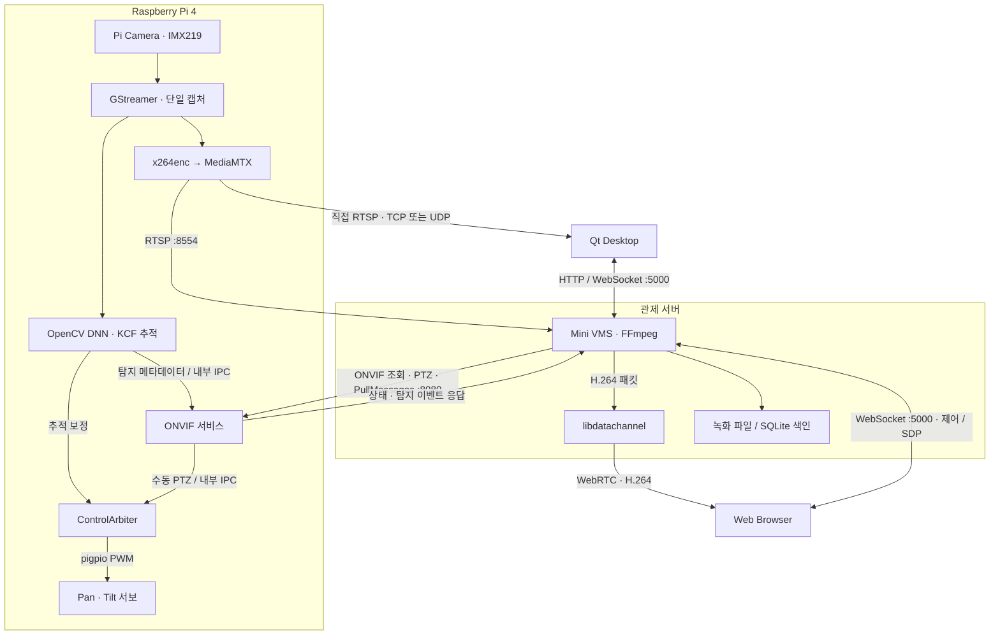

# PTZ Camera & Video Management System

Raspberry Pi가 사람을 탐지해 카메라의 시선을 움직이고, PC의 영상 관제 서버가 그 순간의 영상과 탐지 이력을 연결합니다.

     

[개요](#project-overview) · [구성도](#system-architecture) · [기술 스택](#tech-stack) · [핵심 기능](#core-features) · [저장소](#repository-structure) · [기술 과제](#technical-challenges) · [시연](#demo)

## Project Overview

운영자가 현장의 사람을 따라 카메라를 움직이고, 나중에 해당 장면을 다시 찾을 수 있도록 만든 영상 관제 시스템입니다. Pi에서 카메라 입력을 한 번 열어 영상 송출과 사람 탐지에 함께 사용합니다. 추적을 켜면 Pi가 화면 중심과 대상 위치의 차이를 계산해 Pan·Tilt 서보를 제어합니다.

PC의 Mini VMS(Video Management System)는 같은 카메라에서 H.264 영상과 ONVIF 이벤트를 받아 녹화 파일과 탐지 이력을 관리합니다. 운영자는 웹이나 Qt에서 라이브 영상을 보며 카메라를 조작하고, Qt에서는 검색한 시점의 녹화를 열 수 있습니다.

## System Architecture

**Qt 라이브**는 VMS의 `direct-stream` API에서 카메라 URI를 얻은 뒤 Pi에 직접 접속합니다. **웹 라이브**는 VMS와 WebSocket으로 SDP를 교환하고, 브라우저의 `RTCPeerConnection`으로 영상을 받습니다. 웹 모듈의 Node.js 서버는 HTML·CSS·JavaScript를 제공합니다. [Qt 연결 코드](https://github.com/PTZ-CAMERA/Qt_Client/blob/main/PTZCamera/network/VmsClient.cpp) · [웹 수신 코드](https://github.com/PTZ-CAMERA/PTZ_WEB_Client/blob/main/assets/js/native-webrtc.js)

## Tech Stack

| 영역 | 사용 기술 | 적용 위치 |
| --- | --- | --- |
| 언어 · UI | C++17, JavaScript, HTML, CSS, Qt 6 Widgets | Pi 서비스, VMS, Qt 데스크톱 및 브라우저 UI |
| 하드웨어 · OS | Raspberry Pi 4, Raspberry Pi OS (Linux), IMX219, pigpio | 카메라 입력과 GPIO 18(Pan)·19(Tilt) 서보 PWM |
| 영상 · 추적 | libcamera, GStreamer, x264, MediaMTX, OpenCV DNN, MobileNet-SSD, KCF | Pi에서 H.264 송출, 사람 탐지 및 프레임 간 위치 갱신 |
| 스트리밍 · 저장 | FFmpeg, libdatachannel, Qt Multimedia, SQLite | RTSP 수신, WebRTC 전송, 녹화 파일 색인 및 재생 |
| 네트워크 | RTSP/RTP, ONVIF, HTTP Digest, HTTP, WebSocket, WebRTC | 영상 수신, 장치 제어·이벤트 조회, 클라이언트 신호 교환 |
| 개발 도구 | CMake, CTest, Node.js, Playwright | C++ 빌드·테스트, 웹 정적 서버 및 UI 테스트 |

## Core Features

| 기능 | 구현 방식 |
| --- | --- |
| **사람 탐지와 자동 추적** | MobileNet-SSD로 사람을 검출하고 검출 사이에는 KCF로 위치를 갱신합니다. 중심 오차가 dead zone을 벗어나면 Pan·Tilt를 보정합니다. [Pi 영상·추적](https://github.com/PTZ-CAMERA/PTZ_CAMERA/tree/main/pi/camera_stream) |
| **수동 원격 제어** | Web·Qt의 조작 명령을 VMS가 카메라별로 라우팅합니다. Pi의 제어 중재기는 수동 조작 중 추적 보정을 보류하고, 설정된 대기 시간 뒤 추적 재개 여부를 판단합니다. [VMS 명령 라우터](https://github.com/PTZ-CAMERA/PTZ_VMS_Server/blob/main/src/ptz/PtzCommandRouter.cpp) · [Pi 제어 중재기](https://github.com/PTZ-CAMERA/PTZ_CAMERA/blob/main/pi/servo_test/src/control/control_arbiter.cpp) |
| **브라우저 라이브** | VMS가 RTSP에서 받은 H.264를 재인코딩 없이 RTP로 패킷화합니다. 브라우저는 WebRTC 세션을 열고 실제 영상 프레임 수신을 확인한 뒤 라이브 상태를 표시합니다. [VMS WebRTC](https://github.com/PTZ-CAMERA/PTZ_VMS_Server/blob/main/src/webrtc/WebRtcGateway.cpp) · [Web UI](https://github.com/PTZ-CAMERA/PTZ_WEB_Client/blob/main/assets/js/app.js) |
| **이벤트 기반 녹화** | 자동 녹화 모드에서 추적 활성 상태와 사람 탐지가 확인되면 녹화를 시작합니다. 대상이 사라지면 유예 시간 동안 재탐지를 기다립니다. FFmpeg가 H.264를 MKV 또는 MP4로 분할 저장하고 완료된 구간을 SQLite에 등록합니다. [녹화 모듈](https://github.com/PTZ-CAMERA/PTZ_VMS_Server/tree/main/src/recording) · [VMS 설정](https://github.com/PTZ-CAMERA/PTZ_VMS_Server/blob/main/config/vms.conf) |
| **이력 검색과 녹화 재생** | VMS가 ONVIF PullPoint로 이벤트를 수집합니다. 자연어 검색에서는 Gemini가 만든 조건의 필드와 값을 검증한 뒤 SQLite를 조회합니다. 웹은 녹화 목록을 제공하고, Qt는 클라이언트에서 접근 가능한 파일을 열어 검색 시점으로 이동합니다. [VMS 검색](https://github.com/PTZ-CAMERA/PTZ_VMS_Server/blob/main/src/chat/ChatSearchService.cpp) · [웹 검색 UI](https://github.com/PTZ-CAMERA/PTZ_WEB_Client/blob/main/assets/js/vms-workspace.js) · [Qt 재생](https://github.com/PTZ-CAMERA/Qt_Client/blob/main/PTZCamera/playback/PlaybackWidget.cpp) |

## Repository Structure

| 저장소 | 시스템에서 맡는 역할 | 주요 모듈 |
| --- | --- | --- |
| [PTZ_CAMERA](https://github.com/PTZ-CAMERA/PTZ_CAMERA) | 카메라와 서보를 구동하는 Pi 소프트웨어 | `pi/camera_stream` 캡처·추적, `pi/servo_test` 서보 제어, `pi/onvif_service` 장치·이벤트 서비스 |
| [PTZ_VMS_Server](https://github.com/PTZ-CAMERA/PTZ_VMS_Server) | 카메라 연결, 클라이언트 제어, 영상·이력 관리 | `src/stream` RTSP, `src/webrtc` 브라우저 송출, `src/recording` 녹화, `src/chat` 자연어 검색 |
| [PTZ_WEB_Client](https://github.com/PTZ-CAMERA/PTZ_WEB_Client) | 브라우저 관제 화면 | `assets/js/native-webrtc.js` 미디어 수신, `assets/js/vms-workspace.js` 카메라 등록·녹화·검색 |
| [Qt_Client](https://github.com/PTZ-CAMERA/Qt_Client) | 직접 RTSP 라이브와 녹화 재생을 제공하는 데스크톱 관제 화면 | `PTZCamera/network` VMS 통신, `camera` 영상 표시, `ui` PTZ 입력, `playback` 녹화 재생 |

## Technical Challenges

**늦게 도착한 탐지 결과로 서보가 움직이는 문제**  
Pi에서 소프트웨어 인코딩과 DNN 추론이 CPU를 공유하면서, 추론이 끝났을 때 이미 대상이 이동한 프레임이 생겼습니다. 분석용 GStreamer 큐와 `appsink`를 각각 한 프레임으로 제한해 오래된 입력을 버리고, 추적 제어 단계에서도 허용 나이를 넘긴 결과를 폐기합니다. [진단 기록](https://github.com/PTZ-CAMERA/PTZ_CAMERA/blob/main/troubleshotting.md) · [캡처 파이프라인](https://github.com/PTZ-CAMERA/PTZ_CAMERA/blob/main/pi/camera_stream/src/camera/capture_manager.cpp) · [추적 제어](https://github.com/PTZ-CAMERA/PTZ_CAMERA/blob/main/pi/camera_stream/src/tracking/tracking_controller.cpp)

**녹화 큐가 넘친 뒤 재생 가능한 구간을 만드는 문제**  
쓰기 지연으로 패킷이 누락되면 다음 H.264 프레임이 앞선 프레임을 참조할 수 있습니다. VMS는 현재 녹화 구간을 마무리하고 다음 keyframe에서 새 구간을 시작합니다. 이 경계 덕분에 새 파일의 첫 장면을 독립적으로 디코딩할 수 있습니다. [RecordingManager](https://github.com/PTZ-CAMERA/PTZ_VMS_Server/blob/main/src/recording/RecordingManager.cpp)

**상태 조회가 카메라 연결 해제로 표시되는 문제**  
서보 서비스가 단순 상태 조회용 TCP 연결까지 송출기 연결로 취급해, 조회가 끝날 때 관제 화면에 연결 해제 이벤트를 보냈습니다. 송출기가 `CAMERA:HELLO`로 자신을 등록하도록 하고 `TRACK:STATUS`는 상태만 반환하도록 분리했습니다. [문제 재현과 확인 기록](https://github.com/PTZ-CAMERA/PTZ_CAMERA/blob/main/troubleshotting.md)

## Demo

**Qt 관제 시연 · 1분 9초**  
카메라를 검색해 RTSP 라이브를 열고, 사람이 화면에 들어오면 탐지 상자가 표시되는 장면을 볼 수 있습니다. 이어서 자연어로 탐지 이력을 조회하고 시간순 결과를 확인합니다.

https://github.com/user-attachments/assets/684be118-f6e6-48a7-941e-37718f191e6e

**관제 화면 예시** · 기존 VMS 저장소에 보관된 이전 UI입니다. 중앙의 영상과 오른쪽 Pan·Tilt 조작부, 하단의 ONVIF 장치 정보를 볼 수 있습니다.

| 추가할 시연 자료 | 담을 장면 |
| --- | --- |
| TODO · 동작 이미지 | Pi 카메라와 서보의 실제 움직임, 같은 대상을 표시하는 웹·Qt 라이브 화면 |

